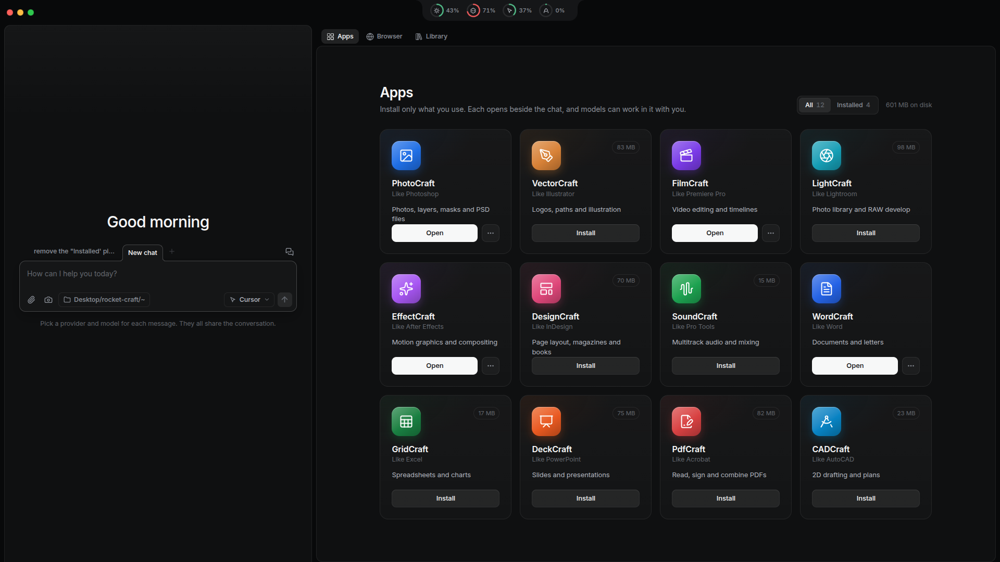
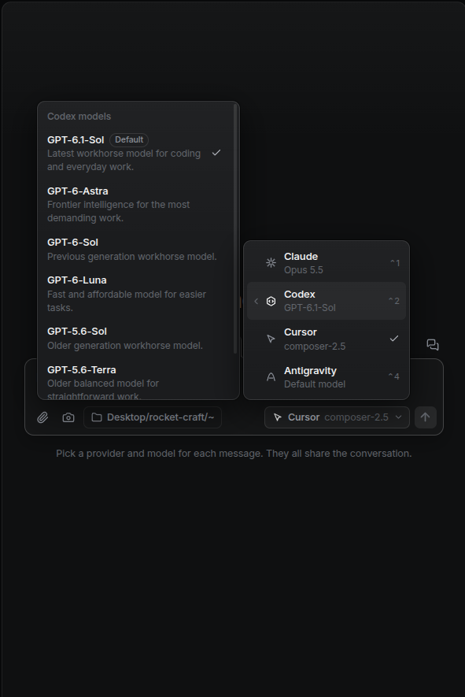
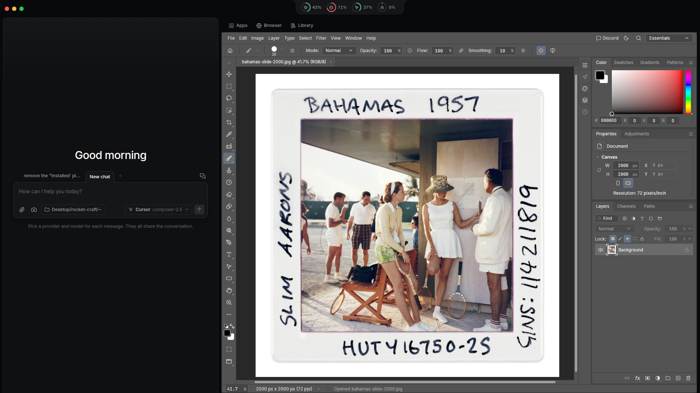
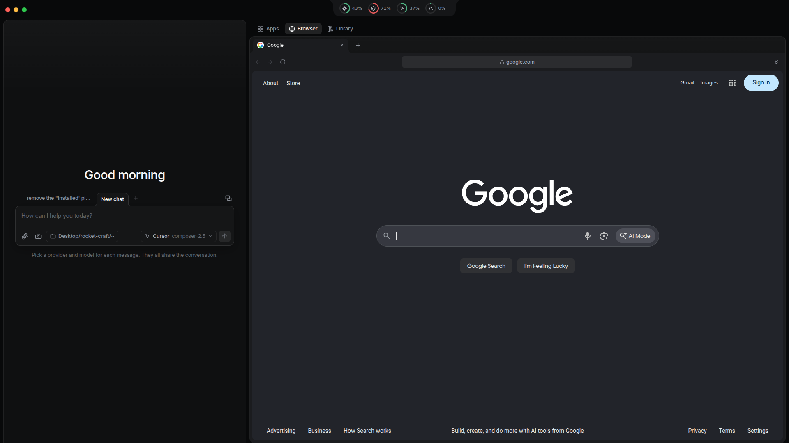
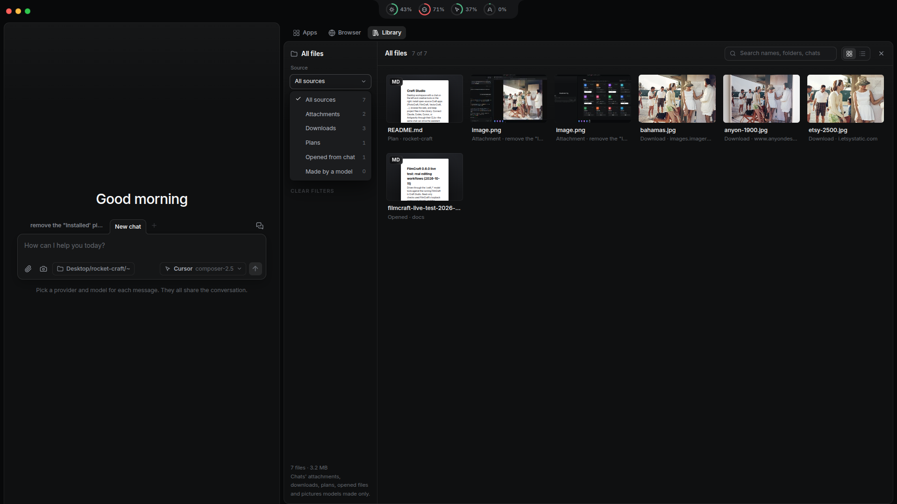

# Craft Studio

Desktop workspace with a chat on the left and creative tools on the right: install open-source **Craft apps** (PhotoCraft, FilmCraft, VectorCraft, …), browse the web, and keep project files in the **Library**. Connect Claude, Codex, Cursor, or Antigravity through their CLIs—the same chat can drive the assistant and the app beside it.

## Screenshots

**Apps** — install only the creative apps you need; open one beside the chat.



**Models** — pick a provider and model per message; the thread stays shared.



**PhotoCraft** — a native app window docked into the right panel.



**Browser** — tabs and an address bar for reference pages and downloads.



**Library** — attachments, downloads, plans, and files opened from chat.



## Requirements

- **Linux** with X11 (native app windows are docked into the right panel)
- **Node.js** 20+
- At least one provider CLI installed and signed in: `claude`, `codex`, `cursor-agent`, or `agy`

## Install and run

```sh
git clone https://github.com/chillysbabybackribs/rocket-craft.git
cd rocket-craft
npm install
npm run dev
```

For a production build:

```sh
npm run build
npm run preview
```

If your shell sets `NODE_ENV=production`, install dev dependencies before building:

```sh
npm ci --include=dev
```

On Linux, `npm run dev` / `preview` / `open` may repair Chromium’s setuid sandbox helper when passwordless `sudo` is available.

## First steps

1. Use **Apps** (top of the right column) to install apps from the catalog.
2. Click **Open** on a card to show that app beside the chat.
3. Switch to **Browser** or **Library** from the same header row.
4. Choose a model in the composer and start chatting.

Your data (chats, settings, installed apps) lives under your OS config and data directories—not in this repository.

## Scripts

| Command | Purpose |
| --- | --- |
| `npm run dev` | Development build with hot reload |
| `npm run preview` | Production build, then launch |
| `npm test` | Unit tests |
| `npm run check:ui` | Build + unit tests + desktop UI checks |
| `npm run open -- <path>` | Open a file or URL in the running app |

## More for contributors

- [DESIGN.md](DESIGN.md) — UI tokens and layout conventions  
- [CLAUDE.md](CLAUDE.md) — architecture and agent tooling  
- [docs/mockups/](docs/mockups/) — HTML mockups used as the UI spec  
